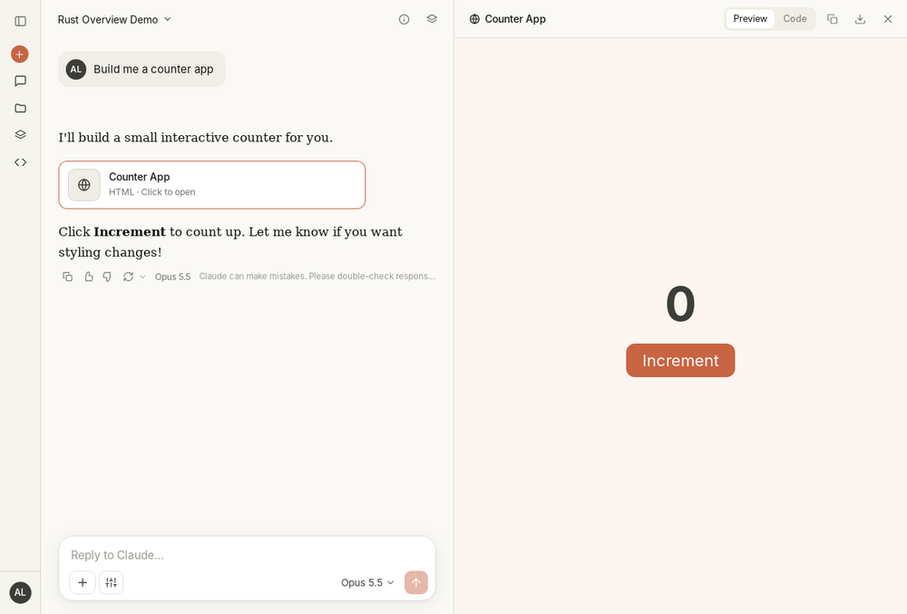
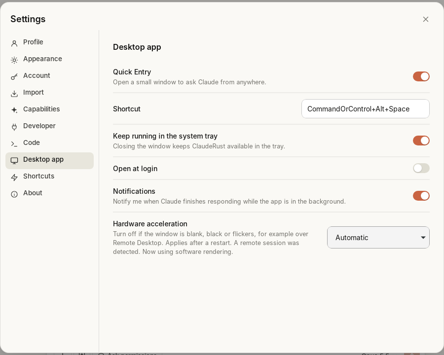
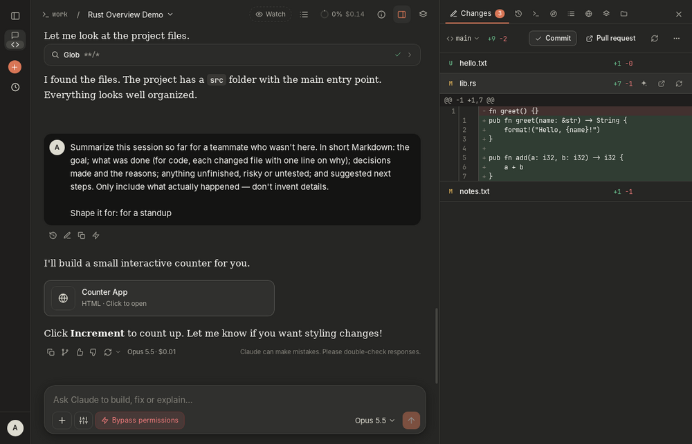
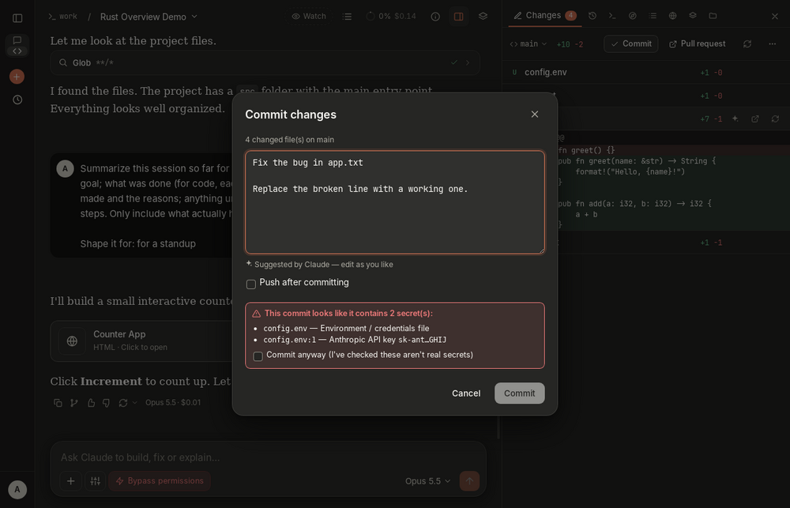
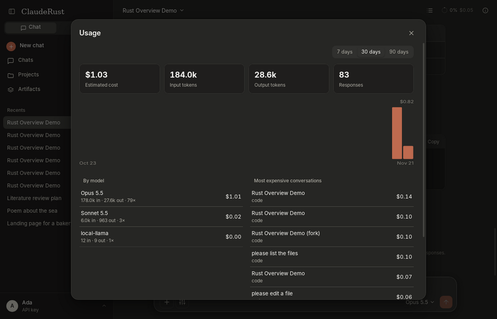

# ClaudeRust

**Claude masaüstü uygulamasının Rust ile yeniden yazılmış, hafif sürümü.**
_A lightweight rewrite of the Claude desktop app in Rust (Tauri 2)._ — [English below](#english)


| Sohbet | Artifact | Kod modu |
|---|---|---|
|  |  |  |
|  |  |  |

| Claude'dan içe aktarma | Uzak Masaüstü / donanım hızlandırma |
|---|---|
|  |  |

| Koyu mod: kod oturumu ve Değişiklikler | Commit öncesi gizli bilgi taraması | Kullanım panosu (`/usage`) |
|---|---|---|
|  |  |  |

## Neden?

Resmî Claude Desktop bir Electron uygulamasıdır (yüzlerce MB disk, ayrı bir Chromium + Node.js çalışma zamanı). ClaudeRust aynı deneyimi şu şekilde sunar:

- **Tüm mantık Rust'ta**: Claude API istemcisi (SSE streaming, yeniden deneme), sohbet ağacı ve dallanma, SQLite depolama ve tam metin arama, Markdown → HTML ve sözdizimi renklendirme (syntect), MCP istemcisi, Kod modu ajanı ve araçları, artifact sunucusu.
- **Arayüz** işletim sisteminin kendi WebView'i ile çizilir (Windows'ta WebView2, macOS'ta WKWebView, Linux'ta WebKitGTK). Ek çalışma zamanı paketlenmez; JS çerçevesi ve derleme adımı yoktur.
- Kurulum paketi birkaç MB'tır, bellek kullanımı Electron uygulamasına göre çok daha düşüktür.

## Özellikler (Claude Desktop ile karşılaştırmalı)

| Claude Desktop | ClaudeRust |
|---|---|
| Sohbet, streaming yanıtlar, Markdown, tablolar, LaTeX, kod blokları | ✅ (Rust'ta render, KaTeX ile matematik) |
| Model seçici, **genişletilmiş düşünme**, efor seviyesi | ✅ Opus 5.5 / Sonnet 5.5 / Haiku 5.5 / Fable 5.2 + diğer modeller; "Düşünce süreci" bloğu |
| Mesaj düzenleme, yeniden deneme, **sürüm gezintisi (‹ 1/2 ›)** | ✅ Tam sohbet ağacı |
| Dosya/görsel/PDF ekleme, yapıştırma, sürükle-bırak | ✅ Görseller otomatik küçültülür; .docx metni çıkarılır; uzun yapıştırmalar dosyaya dönüşür |
| **Artifact'ler** (HTML, React, SVG, Mermaid, Markdown, kod), sürümler, önizleme/kod, indirme | ✅ Ayrı ve sandbox'lı `artifact://` protokolünde |
| **Web araması** ve kaynak gösterme | ✅ Sunucu tarafı web_search / web_fetch araçları, kaynak rozetleri |
| **Projeler**: talimatlar + bilgi dosyaları | ✅ |
| Stiller (Normal, Kısa, Açıklayıcı, Resmi, özel stiller) | ✅ |
| Profil / kişisel tercihler | ✅ |
| **Geçmiş sohbetlerde arama ve referans** (hafıza) | ✅ `conversation_search` / `recent_chats` araçları |
| **MCP sunucuları** (`claude_desktop_config.json`), araç izinleri | ✅ Aynı format; stdio + uzak (Streamable HTTP); Claude Desktop'tan içe aktarma; araç bazında İzin ver / Sor / Engelle |
| **Claude Code** (Kod sekmesi) | ✅ İki motor: **Claude Code** (resmî `claude` CLI'ı çalıştırır, **Claude üyeliğinizle** giriş yapar; oturumlar devam ettirilebilir ve dallanabilir) ya da **API anahtarı** (Rust ile yazılmış yerel ajan: Bash, Read, Write, Edit, Glob, Grep, TodoWrite, ExitPlanMode). İzin modları (İzin iste / Düzenlemeleri otomatik kabul / Plan / İzinleri atla), diff önizlemeli izin kartları, CLAUDE.md |
| **Masaüstü uzantıları** (`.mcpb` / `.dxt`) | ✅ Tek tıkla kurulum, kullanıcı ayarları formu |
| **Hızlı Giriş** (global kısayol) | ✅ Varsayılan `Ctrl+Alt+Space` (macOS: `Option+Space`) |
| Sistem tepsisi, oturum açılışında başlatma, bildirimler | ✅ |
| Açık / koyu / sistem teması, sohbet yazı tipi, yakınlaştırma | ✅ |
| Sohbet arama (Ctrl/⌘+K), yıldızlama, yeniden adlandırma, dışa aktarma | ✅ Markdown / JSON dışa aktarma |
| Arayüz dili | ✅ English, **Türkçe** |
| — | ➕ **Claude'dan içe aktarma**: claude.ai dışa aktarımı (sohbetler, dallar, artifact'ler, projeler), Claude Code oturumları, Claude Desktop MCP sunucuları ve uzantıları |
| — | ➕ **Uzak Masaüstü / VM uyumu**: uzak oturum algılanınca yazılımla çizim, ekran dışında kalan pencereyi geri getirme, "Donanım hızlandırma" ayarı |
| Claude Code'un ajan özellikleri | ✅ **Kod çalışma alanı** (aşağıda): Değişiklikler / Terminal / Plan / Görevler / Önizleme / Harita panelleri, kontrol noktaları ve geri sarma, git worktree yalıtımı, satır içi inceleme yorumları, alt ajanlar, kancalar (hooks), bağlam sıkıştırma, `@` dosya/sembol etiketleme, `/` komutları, CLAUDE.md/AGENTS.md hafızası, Otomatik izin modu |
| — | ➕ **İzleme modu** (dosyalar değişince derleme/test denetimi, hataları Claude'a gönderme), **rutinler** (zamanlanmış istemler), yapay zekâ ile commit mesajı, proje **mimari haritası**, genişletilmiş komut paleti |

### Zorunlu farklar

- **Giriş**:
  - **Kod** sekmesi, resmî Claude Code CLI'ı üzerinden **Claude üyeliğinizle (Pro/Max/Team)** çalışır: giriş Claude Code'un kendi `/login` akışıyla yapılır, ClaudeRust kimlik bilgilerini hiç görmez.
  - **Sohbet** kısmı için **Anthropic API anahtarı** gerekir ([console.anthropic.com](https://console.anthropic.com/settings/keys)); bu kullanım API kredisinden düşer. Anthropic, üçüncü taraf uygulamaların claude.ai hesabıyla giriş sunmasına izin vermez. Bunu yapmanın tek yolu gizli uç noktaları kullanmak ya da oturum belirteçlerini kopyalamak olurdu. Bu güvenli olmaz ve hesabınızı riske atar. Özel bir proxy/ağ geçidi için temel URL değiştirilebilir.
- claude.ai hesabına bağlı özellikler yoktur: sohbetlerin bulut senkronu, paylaşım bağlantıları, claude.ai "Connectors" dizini, sesli mod, Research modu, Chrome entegrasyonu. Sohbetler yalnızca bu bilgisayarda (SQLite) tutulur. Eski sohbetler claude.ai dışa aktarımıyla **içe aktarılabilir** (aşağıya bakın).
- React/Mermaid artifact'leri kütüphaneleri herkese açık CDN'lerden yükler (internet gerekir).
- Sistem istemleri bu proje için yazılmıştır; claude.ai'nin istemlerinin kopyası değildir.

## Kurulum

### Hazır paketler
Her push'ta GitHub Actions üç platform için kurulum paketi üretir: depo → **Actions** → **Build installers** → son çalıştırma → **Artifacts**:

- **Windows**: `.msi` veya `.exe` (NSIS). SmartScreen uyarısında "Ek bilgi → Yine de çalıştır".
- **macOS** (Apple Silicon + Intel, universal): `.dmg`. İmzasız olduğu için ilk açılışta sağ tık → Aç, ya da `xattr -cr /Applications/ClaudeRust.app`.
- **Linux**: `.deb`, `.rpm`, `.AppImage`.

`v0.1.0` gibi bir etiket gönderilirse **Release** iş akışı, paketleri taslak bir GitHub Release'e ekler.

### Kaynaktan derleme
Gereksinimler: Rust (stable), Node.js 18+ (yalnızca Tauri CLI için), Linux'ta `libwebkit2gtk-4.1-dev libayatana-appindicator3-dev librsvg2-dev libxdo-dev libssl-dev`.

```bash
npm install          # Tauri CLI
npx tauri dev        # geliştirme modunda çalıştır
npx tauri build      # kurulum paketi üret (target/release/bundle)
cargo test -p clauderust --lib   # birim testleri
cargo clippy -p clauderust --lib -- -D warnings
npm run lint         # arayüz için ESLint
```

Arayüz dosyaları (`ui/`) ikili dosyaya gömülür: arayüzde değişiklik yaptıktan sonra `cargo build` gerekir (`src-tauri/build.rs` dosyasına `touch` yeterli). Hata ayıklama derlemelerinde `CLAUDERUST_EVAL_DIR` ile uygulama içinde betik çalıştırılabilir; uçtan uca testler bu kancayla, Xvfb altında ve sahte bir API sunucusuyla yapılır.

## Kullanım notları

- **İlk açılış**: adınızı ve API anahtarınızı girin. Anahtar macOS'ta Keychain'de, Windows'ta Credential Manager'da, Linux'ta uygulama veritabanında saklanır.
- **MCP**: Ayarlar → Geliştirici → *Yapılandırmayı düzenle*. Dosya konumu:
  - Windows: `%APPDATA%\dev.clauderust.desktop\claude_desktop_config.json`
  - macOS: `~/Library/Application Support/dev.clauderust.desktop/claude_desktop_config.json`
  - Linux: `~/.config/dev.clauderust.desktop/claude_desktop_config.json`

  ```json
  {
    "mcpServers": {
      "filesystem": {
        "command": "npx",
        "args": ["-y", "@modelcontextprotocol/server-filesystem", "/Users/me/Desktop"]
      },
      "uzak-sunucu": { "url": "https://example.com/mcp", "headers": { "Authorization": "Bearer ..." } }
    }
  }
  ```
  Claude Desktop'ta zaten sunucularınız varsa *Claude Desktop'tan içe aktar* düğmesi onları kopyalar. GUI uygulamaları kabuk PATH'ini devralmadığı için ClaudeRust, `npx`/`uvx` gibi komutları giriş kabuğunuzun PATH'i ile çözer.
- **Kod modu**: Kenar çubuğu → Kod → klasör seçin (veya yolu yapıştırın) → görev yazın. Dosya düzenlemeleri ve komutlar izin kartıyla onaylanır. Proje kökündeki `CLAUDE.md` ve `~/.claude/CLAUDE.md` talimat olarak yüklenir.
  - Seçilen klasörün **dışındaki** her dosya erişimi (okuma dahil) izin ister; "Düzenlemeleri otomatik kabul et" modu yalnızca proje klasörü içinde geçerlidir.
  - Yalnızca okuma yapan basit komutlar (`ls`, `cat`, `git status`, `rg` …) sorulmadan çalışır; yönlendirme (`>`), komut ikamesi (`$(...)`), arka plan (`&`) ya da proje dışı yol içeren her komut izin ister. "Bu oturum için izin ver" kuralları zincirdeki her komutu ayrı ayrı denetler.
  - Komut çıktısı 2 MB ile, süre 2 dakika (en fazla 10) ile sınırlıdır; "Durdur" çalışan komutu ve alt süreçlerini sonlandırır.
- **Claude üyeliğiyle Kod**: [Claude Code](https://docs.claude.com/en/docs/claude-code/setup)'u kurun, Ayarlar → Kod → *Claude Code'a giriş yap* düğmesine basın (bir terminal açılır, orada `/login` ile Claude hesabınızı seçin). Yeni oturumlar Kod sayfasındaki **Claude Code / API anahtarı** seçimine göre çalışır; ilk açılışta "Claude üyeliğimi Claude Code ile kullan" seçilirse API anahtarı hiç gerekmez. CLI farklı bir yerdeyse yolunu Ayarlar → Kod'dan girebilirsiniz.
- **Claude'dan içe aktarma** (hesap menüsü → *Claude'dan içe aktar…* ya da Ayarlar → İçe aktar):
  - **Sohbetler ve projeler**: Claude Desktop sohbetleri bilgisayarda değil claude.ai'de tutar. claude.ai → Ayarlar → Gizlilik → *Verileri dışa aktar* ile gelen zip'i seçin ya da sekmeye sürükleyin. Düzenleme dalları, ekler, düşünce blokları, artifact'ler (güncellemeleriyle sürüm sürüm) ve proje talimatları/dosyaları gelir. Tarihler korunur, tekrar içe aktarmak kopya oluşturmaz.
  - **Claude Code oturumları** (`~/.claude/projects`; CLI ve Claude Desktop'ın Kod sekmesi): içe aktarılan oturumlar Claude Code motoruyla **kaldığı yerden devam eder**.
  - **Claude Desktop bağlayıcıları**: `claude_desktop_config.json` içindeki MCP sunucuları ve Claude'da kurulu masaüstü uzantıları (kayıtlı ayarlarıyla), ayrıca `~/.claude.json` içindeki Claude Code MCP sunucuları.
- **Uzak Masaüstü, VM ve GPU sorunları**: Uzak bir oturum (Windows RDP, xrdp, VNC, Chrome Uzak Masaüstü, X yönlendirme) algılanınca ClaudeRust yazılımla çizime geçer. Linux'ta boş/beyaz pencereye yol açan DMA-BUF çizicisi varsayılan olarak kapalıdır. Kayıtlı konumu artık var olmayan bir ekranda kalan pencere görünür ekrana taşınır ve ekrandan büyükse küçültülür. Pencere yine boş ya da siyahsa Ayarlar → Masaüstü uygulaması → **Donanım hızlandırma → Kapalı** seçin. Pencere hiç açılmıyorsa uygulamayı `--disable-gpu` ile ya da `CLAUDERUST_DISABLE_GPU=1` ortam değişkeniyle başlatın.
- **Kod çalışma alanı** (kod oturumlarında sağdaki panel, `Ctrl+\``):
  - **Değişiklikler**: git'te HEAD'e göre (git dışında ajanın düzenlemelerine göre) değişen dosyalar, satır numaralı diff, dosya/tümünü geri alma, satırlara **inceleme yorumu** ekleyip hepsini tek istemle gönderme, Claude'un yazdığı mesajla **commit** (isteğe bağlı push).
  - **Terminal**: proje klasöründe gerçek bir kabuk (PTY). **Görevler**: arka plan komutları ve alt ajanlar, canlı çıktı ve durdurma. **Plan**: plan modunun planı ve yapılacaklar listesi. **Önizleme**: yerel geliştirme sunucusunu (localhost) uygulama içinde açar; komut çıktısındaki adresler otomatik bulunur. **Harita**: dosyalar arası içe aktarma grafiği.
  - **Kontrol noktaları / geri sarma**: her turdan önce proje dosyalarının anlık görüntüsü alınır (uygulama veri klasöründe ayrı bir git deposu; projenin `.git`'ine dokunulmaz). Mesajınızın yanındaki ⟲ düğmesi ya da `/rewind` ile kodu, sohbeti ya da ikisini birden o noktaya döndürün; kod geri yüklemesi geri alınabilir.
  - **Worktree yalıtımı**: aynı depoda başka bir oturum çalışırken (ayar: her zaman / asla) yeni oturum kendi `clauderust/…` dalında ve worktree'sinde çalışır; "…dalına uygula" değişiklikleri ana klasöre aktarır, oturum silinince worktree temizlenir.
  - **İzin modları**: İzin iste, **Otomatik** (güvenli düzenleme ve komutlar sormadan; `sudo`, `git push`, `--force`, proje dışına silme/yazma, ağ araçları, `.env`/anahtar dosyaları gibi riskli işlemler için sorar), Düzenlemeleri kabul et, Plan, İzinleri atla.
  - **Girdi**: `@` dosya ve sembol (fonksiyon/tip) etiketleme, `/` komutları (`/compact`, `/cost`, `/review`, `/init`, `/doctor`, `/memory`, `/rewind`, `/hooks`, `/watch`, `/schedule`, `/clear`, `/model`, `/permissions` …) ve `.claude/commands/*.md` özel komutları; mesajları "/komut olarak kaydet"; `# not` ile hafızaya ekleme.
  - **Hafıza**: `~/.claude/CLAUDE.md`, üst klasörlerdeki `CLAUDE.md`, `.claude/CLAUDE.md`, `AGENTS.md`, `CLAUDE.local.md` (`@yol` içe aktarmalarıyla) her mesajda yeniden okunur.
  - **Bağlam**: üst çubukta bağlam doluluğu ve maliyet; `/compact` ya da bağlam %85 dolunca otomatik özetleme.
  - **Alt ajanlar**: yerleşik ajan karmaşık işleri `Task` aracıyla paralel alt ajanlara bölebilir.
  - **Kancalar (hooks)**: Claude Code biçimi (`PreToolUse`, `PostToolUse`, `UserPromptSubmit`, `Stop`, `SessionStart`); proje kancaları yalnızca siz onayladıktan sonra çalışır.
  - **İzleme modu**: üst çubuktaki *İzle* rozeti; dosyalar değiştikçe algılanan denetim komutunu (cargo check, tsc, go build, npm script …) çalıştırır, hataları tek tıkla ya da otomatik olarak Claude'a gönderir.
  - **Rutinler**: Kod sayfası → *Rutinler*: belirli aralıklarla ya da her gün belirli saatte yeni bir kod oturumunda çalışan istemler.
  - **Geçmiş**: son commit'ler ve dosya bazında diff'leri; Claude'a commit'i açıklatma, commit'i yeni bir commit'le geri alma. **Dosyalar** (`Alt+8`): proje ağacı (.gitignore'a uyar), filtre, sözdizimi renkli salt okunur görüntüleyici; dosyayı ya da satırı (`@yol#L50`) mesaja etiketleme, düzenleyicide açma.
  - **Terminal → Claude**: Terminal panelindeki *Claude'a sor* düğmesi seçimi ya da son çıktıyı mesaja ekler veya "hataları düzelt" istemiyle hemen gönderir.
  - **Harcama sınırı**: Ayarlar → Kod → *Tur başına harcama sınırı* ya da `/budget 2.50`: bir ajan turu bu tutara ulaşınca duraklar (Devam düğmesiyle sürer); Claude Code oturumlarında `--max-budget-usd` kullanılır.
  - **Çekme isteği**: Değişiklikler → *Çekme isteği*: dal → ana dal, öndeki commit'ler ve açık bir istek varsa bağlantısı; başlık ve açıklamayı Claude yazar; *Oluştur* dalı gönderir ve `gh pr create` çalıştırır (taslak seçeneği; ana daldaysanız yeni dal önerir). `gh` yoksa GitHub/GitLab karşılaştırma sayfası açılır.
  - **Dosyalarda arama**: Dosyalar panelinde büyüteç modu: düz metin ya da düzenli ifade, büyük/küçük harf seçeneği; sonuçlar dosya bazında, tıklayınca o satırda açılır. Görüntüleyicide *Claude'a sor* (açıkla / incele / test yaz), yol kopyalama, klasörde gösterme.
  - **`/todos`**: projedeki TODO / FIXME / HACK / XXX / BUG yorumları; tıklayınca o satır, *Düzelt* ile Claude'a gönderme.
  - **Tur özeti ve komutlar**: her kod yanıtının altında düzenlenen dosyalar (+/− satır); yanıtlardaki kabuk kod bloklarında *Çalıştır* komutu terminale yapıştırır (Enter'a basana kadar çalışmaz); 20 sn'den uzun süren arka plan komutları bitince masaüstü bildirimi.
  - **Git araçları**: Değişiklikler'de dal menüsü (dallar arası geçiş, yeni dal, stash / geri uygulama), tek bir parçayı (hunk) geri alma, tüm değişiklikleri yama olarak kopyalama/kaydetme ve yapıştırılan yamayı uygulama; commit öncesi gizli bilgi taraması (API anahtarları, özel anahtarlar, `.env` dosyaları); Dosyalar görüntüleyicisinde satır satır *blame* ve dosyayı düzenleyen sohbetler; `/review <PR no ya da URL>` ile GitHub çekme isteği incelemesi.
  - **Proje betikleri**: Görevler panelinde package.json / Makefile / justfile / Cargo / Go / pytest komutları; tek tıkla terminalde çalıştırma ya da Claude'a çalıştırıp düzelttirme.
  - **Oturum araçları**: `/recap` (oturum özeti), klasör menüsü (düzenleyicide aç, terminal aç), Claude Code oturumunu sistem terminalinde sürdürme (`claude --resume`), her yanıtın süresi ve maliyeti.
  - **Kod sayfası**: 6'dan fazla oturum olunca başlık ya da klasöre göre süzme kutusu; oturumlar klasörlerine göre gruplanır ve her birinde *Çalışıyor* / *Sizi bekliyor* durumu canlı görünür (paralel oturumlar için).
  - **`/tour [alan]`**: yeni gelen biri için kod tabanında salt okunur rehberli tur (ne yaptığı, mimari ve dosya yolları, nereden başlanacağı). `@klasör/` etiketleri klasörün yapısını (3 düzey, .gitignore'a uyarak) ağaç olarak ekler.
  - **Geçmişte arama**: commit mesajında, yazarda ya da eklenen/silinen kodda (git'in `-S` araması).
  - **Aşırı yükte model değişimi**: seçilen model meşgulse tur otomatik olarak başka bir modelle sürer (Ayarlar → Özellikler; Claude Code'da `--fallback-model`).
  - **Düzenleyicide aç**: araç kartlarındaki, Değişiklikler'deki ve Harita'daki dosya yolları VS Code / Cursor / Zed / IntelliJ … ile ilgili satırda açılır (Ayarlar → Kod).
- **Sohbet araçları**: *Mesajımı iyileştir* (araçlar menüsü; hızlı model taslağı daha açık hâle getirir, Geri al ile eski metne dönülür), *Bu sohbet için talimatlar* (sohbet menüsü; yalnızca o sohbette geçerli sistem talimatı), kod bloklarını dosya olarak kaydetme, gönderilmemiş taslakların yeniden başlatmadan sonra da korunması, yanıttaki metni seçip *Alıntıla* / *Açıkla*, gönderilen mesajlarda arama (`Ctrl/⌘+R`), sohbet genişliği (normal / geniş / tam), sohbet içinde arama (`Ctrl/⌘+F`), her yanıtın altındaki dal düğmesiyle sohbeti o noktadan **yeni bir sohbete çatallama**, Claude yanıt verirken yazılan mesajları **sıraya koyma**, `@https://…` ile bir sayfayı bağlama ekleme, `/context` ile bağlam penceresinin dökümü, `/usage` ile 7/30/90 günlük maliyet panosu, sohbeti **HTML rapor** olarak dışa aktarma.
- **Büyük loglar ve çökme dökümleri**: bağlama sığmayacak kadar büyük metin ekleri (log, crash raporu, yapıştırılan çıktı; 40 MB'a kadar) özetlenerek gönderilir: genel bakış, sayılarıyla gruplanmış farklı hatalar/uyarılar, ilk geçtikleri yerlerin çevresi ve yığın izleri, dosyanın başı ve sonu.
- **Yerel ve diğer modeller**: Ayarlar → Hesap → *Yerel ve diğer modeller*: Ollama, LM Studio, llama.cpp, vLLM, OpenRouter gibi OpenAI uyumlu bir uç nokta; modelleri model menüsünde `oai:` önekiyle görünür (sohbetlerde).
- **Sohbet / Kod ayrımı**: Claude Desktop'taki gibi kenar çubuğunun üstünde *Sohbet* / *Kod* geçişi; Sohbet'te yeni sohbet, sohbetler, projeler, artifact'ler ve yalnızca sohbetler; Kod'da yeni oturum, rutinler ve klasör adıyla yalnızca kod oturumları.
- **Ayar yedeği**: Ayarlar → Hakkında → *Dosyaya kaydet* / *Geri yükle*: tercihler, stiller ve kısayollar bir JSON dosyasına yazılır. API anahtarları, sunucu adresleri, düzenleyici komutu, izin ayarları ve bu makineye özgü yollar dosyaya girmez ve geri yüklemede değişmez.
- **Koyu mod**: Ayarlar → Görünüm → Açık / Koyu / Sistemle eşleş. Tüm sayfalar, paneller ve iletişim kutuları (diff renkleri, terminal, onay kutuları dahil) tema renklerini kullanır.
- **Klavye kısayolları**: Yeni sohbet `Ctrl/⌘+Shift+O`, arama ve komut paleti `Ctrl/⌘+K` (`>` komutlar, `@` dosyalar), sohbette bul `Ctrl/⌘+F`, gönderilen mesajlar `Ctrl/⌘+R`, son sohbetler arasında `Ctrl+Tab`, mesajlarınız arasında `Alt+↑/↓` (üst çubukta ana hat), panel sekmeleri `Alt+1…8`, çalışma alanı/terminal ``Ctrl/⌘+` ``, kenar çubuğu `Ctrl/⌘+B`, ayarlar `Ctrl/⌘+,`, durdur `Esc`, son mesajı düzenle `↑`, yakınlaştır `Ctrl/⌘ + / − / 0`, tüm liste `Ctrl/⌘+/`. Kısayolların çoğu Ayarlar → Kısayollar'dan değiştirilebilir.

---

## English

ClaudeRust recreates the Claude desktop experience — chats, projects, artifacts, web search, MCP servers, a Claude Code–style coding agent, Quick Entry and the tray — as a small native app. All application logic is Rust; the UI is plain HTML/CSS/JS rendered by the operating system's WebView (no Electron, no bundled browser, no JS build step).

**Signing in:** Code sessions can run through the official Claude Code CLI, which signs in with your **Claude subscription** through its own `/login` (ClaudeRust never sees the credentials); sessions resume and branch like in Claude Desktop. A built-in Rust agent with the same tool set is available as the API-key engine. Chat needs an Anthropic API key: Anthropic doesn't allow third-party apps to offer claude.ai sign-in, and doing it anyway would mean private endpoints or copied session tokens.

**Import from Claude:** Settings → Import brings over a claude.ai data export (chats with their edit branches, attachments, thinking, versioned artifacts, and projects with their instructions and documents), Claude Code sessions from `~/.claude/projects` (they stay resumable), Claude Desktop's MCP servers and installed extensions, and Claude Code's user MCP servers.

**Remote Desktop / VMs:** in remote sessions (RDP, xrdp, VNC, Chrome Remote Desktop, X forwarding) the WebView uses software rendering; on Linux the DMA-BUF renderer is off by default; a window restored onto a missing monitor is moved back on screen. Settings → Desktop app → *Hardware acceleration* overrides this, and `--disable-gpu` / `CLAUDERUST_DISABLE_GPU=1` help when the window doesn't open at all.

**Code workspace:** code sessions get a side panel (``Ctrl+` ``) with Changes (diff vs HEAD, revert, inline review comments, commit with a Claude-written message), a real PTY Terminal, Plan (plan + todos), Tasks (background commands and sub-agents), Preview (local dev server in-app) and Map (import graph). Also: per-turn checkpoints with rewind (code and/or conversation), git worktree isolation for parallel sessions, an Auto permission mode, `@` file/symbol mentions, `/` commands (including `.claude/commands`), CLAUDE.md/AGENTS.md memory, compaction with a context/cost meter, sub-agents, Claude Code-format hooks (project hooks run only once trusted), watch mode (re-run a check on file changes and send failures to Claude) and routines (scheduled prompts).

**More tools:** History pane (commits, per-file diffs, explain/revert a commit) and Files pane (`Alt+8`: gitignore-aware tree, filter, highlighted viewer; mention a file or a line as `@path#L50`); "Ask Claude" in the Terminal pane sends the selection or recent output (or asks for a fix right away); a per-turn spending limit (Settings → Code or `/budget 2.50`; `--max-budget-usd` for Claude Code sessions); open files in your editor at the line; find in conversation (`Ctrl/⌘+F`); fork a conversation from any answer; queue messages while Claude works; `@https://…` mentions; `/context` breakdown and a `/usage` cost dashboard; HTML report export; large logs and crash dumps (up to 40 MB) are sent as a digest (grouped errors with counts, stack-trace context, start and end); an OpenAI-compatible endpoint for local models (Ollama, LM Studio, llama.cpp, vLLM, OpenRouter) in chats.

**Chat and Code are separate**, as in Claude Desktop: a Chat / Code switch at the top of the sidebar; each mode has its own navigation and its own list (chats, or code sessions with their folders).

**Git and project tools:** create pull requests from the Changes pane (Claude drafts the title and description; `gh pr create`, or the GitHub/GitLab compare page without `gh`); search inside files (text/regex) from the Files pane; `/todos` for TODO/FIXME comments; a per-turn "Edited N files" summary; *Run* on shell snippets pastes them into the terminal; notifications when long background commands finish; automatic fallback to another model when the chosen one is overloaded; quote/explain a selection; Ctrl/⌘+R searches messages you've sent; conversation width setting; customizable shortcuts (Settings → Shortcuts).

**More git and session tools:** a branch menu in the Changes pane (switch, create, stash / apply), revert a single hunk, copy/save all changes as a patch and apply a pasted patch, a secret scan before committing, per-line blame and "conversations that edited this file" in the Files viewer, `/review <PR number or URL>` for GitHub pull requests, project scripts (package.json, Makefile, justfile, Cargo, Go, pytest) one click away in the Tasks pane, `/recap`, a folder menu (open in editor / terminal), continuing a Claude Code session in the system terminal, each answer's time and cost, and a conversation outline with Alt+↑/↓ between your messages.

**Since then:** *Improve my message* (composer tools menu, with Undo), *Instructions for this conversation* (conversation menu), save a code block as a file, drafts that survive a restart, `/tour [area]` (a read-only guided tour of the codebase), `@folder/` mentions that include the folder's layout, History search (message, author, or code added/removed), a Code page filter with sessions grouped by folder and live *Working* / *Needs you* status, and a settings backup (Settings → About; API keys, server addresses, the editor command, permission settings and machine-specific paths are neither saved nor overwritten). Every page, pane and dialog uses the theme's colours in dark mode (Settings → Appearance).

**Testing:** `cargo test -p clauderust --lib`, `cargo clippy -p clauderust --lib -- -D warnings` and `npm run lint` (ESLint). The UI is embedded in the binary, so UI changes need a `cargo build`. Debug builds can run scripts inside the window (`CLAUDERUST_EVAL_DIR`); the end-to-end checks drive the app that way under Xvfb against a mock API.

**Other differences:** no cloud sync, chat sharing, voice mode, Research mode or claude.ai connector directory; React/Mermaid artifacts load their libraries from public CDNs.

**Install:** download the installer for your platform from the latest *Build installers* workflow run (Actions → Artifacts), or from a GitHub Release. macOS builds are unsigned (right-click → Open, or `xattr -cr`). **Build from source:** `npm install && npx tauri build`.

### Architecture

```
src-tauri/src
├── anthropic.rs    Claude API client: SSE parsing, retries, content-block accumulator
├── engine.rs       request building, streaming loop, tool execution, permissions, titles
├── render.rs       stored messages → UI turns (thinking, tools, citations, artifacts)
├── markdown.rs     safe Markdown → HTML (raw HTML escaped, safe links, math placeholders)
├── highlight.rs    syntect-based highlighting with themeable CSS classes
├── artifacts.rs    <antArtifact> parsing and sandboxed documents for artifact://
├── mcp.rs          MCP client (stdio + streamable HTTP), claude_desktop_config.json
├── codetools.rs    Bash / Read / Write / Edit / Glob / Grep / TodoWrite + permission rules (incl. Auto mode)
├── shells.rs       background commands (run_in_background, BashOutput, KillShell)
├── terminal.rs     PTY terminals for the Terminal pane
├── gitops.rs       changes, diffs and revert (git or recorded originals)
├── checkpoints.rs  per-turn snapshots in a shadow git repo; rewind
├── worktree.rs     isolated git worktrees per session
├── subagent.rs     Task tool: parallel sub-agents
├── hooks.rs        Claude Code-format hooks with a trust check
├── compact.rs      context compaction
├── memory.rs       CLAUDE.md / AGENTS.md loading, quick memory
├── slash.rs        custom /commands (.claude/commands)
├── filesearch.rs   @ file search and mention expansion
├── symbols.rs      @ symbol index
├── watch.rs        watch mode (check on file changes)
├── routines.rs     scheduled prompts
├── archmap.rs      import graph for the Map pane
├── claudecode.rs   Claude Code CLI engine: stream-json, permission prompts, resume/fork
├── import.rs       import from claude.ai exports, Claude Code sessions, Claude Desktop
├── extensions.rs   .mcpb / .dxt desktop extensions
├── display.rs      WebView rendering flags (remote sessions, GPU), keep window on screen
├── db.rs           SQLite: conversation tree, projects, artifacts, FTS5 search
├── models.rs       model catalog, thinking/effort rules, server tool variants
├── prompts.rs      system prompts for chat and code sessions
├── attachments.rs  images (downscaling), PDFs, .docx, text files
├── commands.rs     Tauri commands used by the UI
└── lib.rs          windows, tray, Quick Entry, global shortcut, artifact protocol
ui/                 index.html, css/app.css, js/*.js + js/panes/*.js (ES modules), vendor/katex, vendor/xterm
```

Conversation history is sent back to the API append-only and unchanged (thinking blocks, server tool results and fallback markers included), so prompt caching and preserved thinking keep working across tool loops, branches and model switches.

### Third-party notices
KaTeX and xterm.js are bundled under their MIT licenses (`ui/vendor/katex/LICENSE`, `ui/vendor/xterm/LICENSE`). "Claude" is a trademark of Anthropic; this is an independent client for the Claude API.
