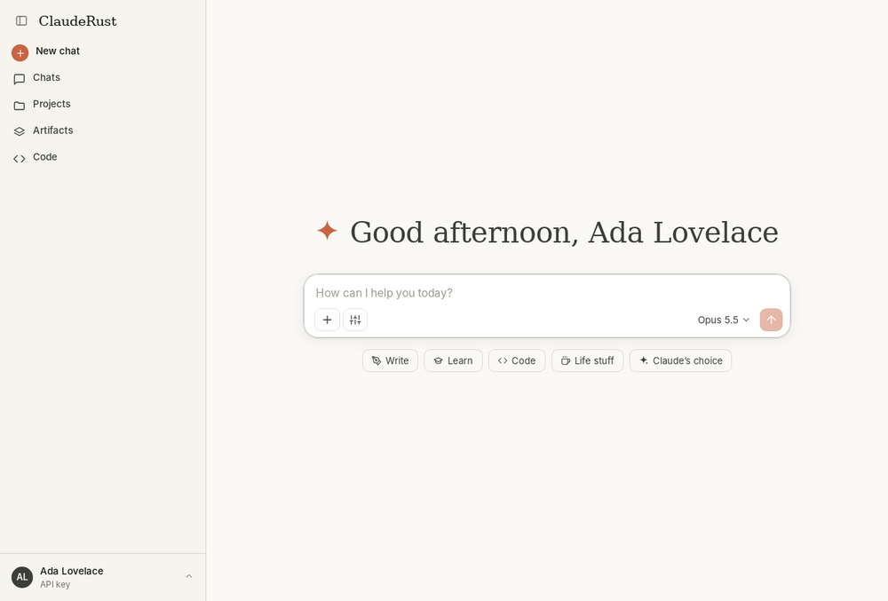
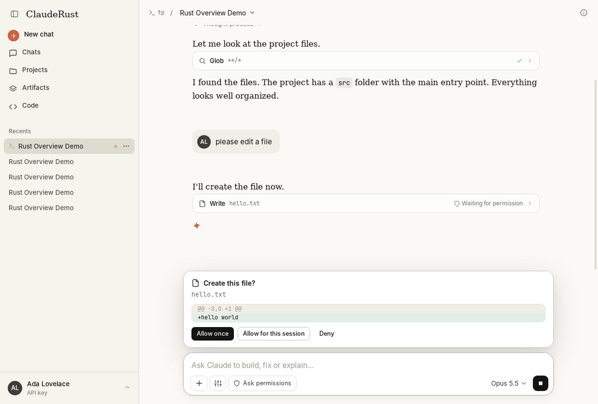
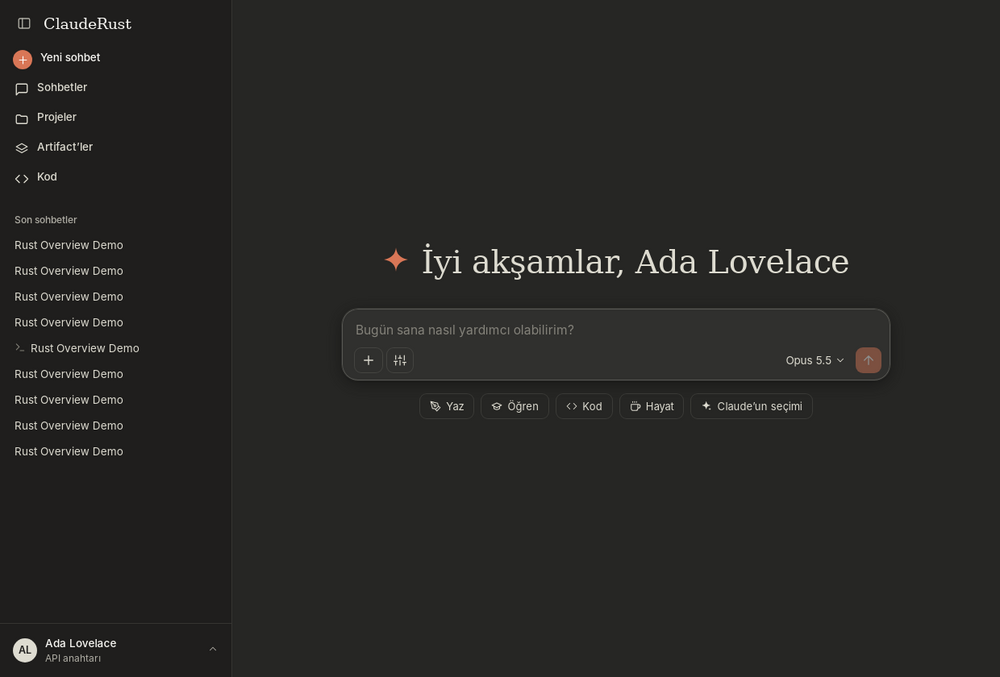

# ClaudeRust

**Claude masaüstü uygulamasının Rust ile yeniden yazılmış, hafif sürümü.**
_A lightweight rewrite of the Claude desktop app in Rust (Tauri 2)._ — [English below](#english)



| Sohbet | Artifact | Kod modu |
|---|---|---|
|  |  |  |
|  |  |  |

## Neden?

Resmî Claude Desktop bir Electron uygulamasıdır (yüzlerce MB disk, ayrı bir Chromium + Node.js çalışma zamanı). ClaudeRust aynı deneyimi şu şekilde sunar:

- **Tüm mantık Rust'ta**: Claude API istemcisi (SSE streaming, yeniden deneme), sohbet ağacı ve dallanma, SQLite depolama ve tam metin arama, Markdown → HTML ve sözdizimi renklendirme (syntect), MCP istemcisi, Kod modu ajanı ve araçları, artifact sunucusu.
- **Arayüz** işletim sisteminin kendi WebView'i ile çizilir (Windows'ta WebView2, macOS'ta WKWebView, Linux'ta WebKitGTK). Ek çalışma zamanı paketlenmez; JS çerçevesi ve derleme adımı yoktur.
- Kurulum paketi birkaç MB'tır, bellek kullanımı Electron uygulamasına göre çok daha düşüktür.

## Özellikler (Claude Desktop ile karşılaştırmalı)

| Claude Desktop | ClaudeRust |
|---|---|
| Sohbet, streaming yanıtlar, Markdown, tablolar, LaTeX, kod blokları | ✅ (Rust'ta render, KaTeX ile matematik) |
| Model seçici, **genişletilmiş düşünme**, efor seviyesi | ✅ Opus 5.5 / Sonnet 5.5 / Haiku 5.5 / Fable 5.2 + diğer modeller; "Düşünce süreci" bloğu |
| Mesaj düzenleme, yeniden deneme, **sürüm gezintisi (‹ 1/2 ›)** | ✅ Tam sohbet ağacı |
| Dosya/görsel/PDF ekleme, yapıştırma, sürükle-bırak | ✅ Görseller otomatik küçültülür; .docx metni çıkarılır; uzun yapıştırmalar dosyaya dönüşür |
| **Artifact'ler** (HTML, React, SVG, Mermaid, Markdown, kod), sürümler, önizleme/kod, indirme | ✅ Ayrı ve sandbox'lı `artifact://` protokolünde |
| **Web araması** ve kaynak gösterme | ✅ Sunucu tarafı web_search / web_fetch araçları, kaynak rozetleri |
| **Projeler**: talimatlar + bilgi dosyaları | ✅ |
| Stiller (Normal, Kısa, Açıklayıcı, Resmi, özel stiller) | ✅ |
| Profil / kişisel tercihler | ✅ |
| **Geçmiş sohbetlerde arama ve referans** (hafıza) | ✅ `conversation_search` / `recent_chats` araçları |
| **MCP sunucuları** (`claude_desktop_config.json`), araç izinleri | ✅ Aynı format; stdio + uzak (Streamable HTTP); Claude Desktop'tan içe aktarma; araç bazında İzin ver / Sor / Engelle |
| **Claude Code** (Kod sekmesi) | ✅ Rust ile yazılmış yerel ajan: Bash, Read, Write, Edit, Glob, Grep, TodoWrite, ExitPlanMode; izin modları (İzin iste / Düzenlemeleri otomatik kabul / Plan / İzinleri atla); diff önizlemeli izin kartları; CLAUDE.md desteği |
| **Hızlı Giriş** (global kısayol) | ✅ Varsayılan `Ctrl+Alt+Space` (macOS: `Option+Space`) |
| Sistem tepsisi, oturum açılışında başlatma, bildirimler | ✅ |
| Açık / koyu / sistem teması, sohbet yazı tipi, yakınlaştırma | ✅ |
| Sohbet arama (Ctrl/⌘+K), yıldızlama, yeniden adlandırma, dışa aktarma | ✅ Markdown / JSON dışa aktarma |
| Arayüz dili | ✅ English, **Türkçe** |

### Zorunlu farklar

- **Giriş**: claude.ai / Google hesabıyla giriş yerine **Anthropic API anahtarı** kullanılır ([console.anthropic.com](https://console.anthropic.com/settings/keys)). Bu yüzden kullanım Pro/Max aboneliğinden değil, API kredisinden düşer. Özel bir proxy/ağ geçidi için temel URL değiştirilebilir.
- claude.ai hesabına bağlı özellikler yoktur: sohbetlerin bulut senkronu, paylaşım bağlantıları, claude.ai "Connectors" dizini, sesli mod, Research modu, Chrome entegrasyonu. Sohbetler yalnızca bu bilgisayarda (SQLite) tutulur.
- Kod modu resmî Claude Code CLI'ını çalıştırmaz; aynı araç setinin Rust ile yazılmış yerel bir uygulamasıdır.
- React/Mermaid artifact'leri kütüphaneleri herkese açık CDN'lerden yükler (internet gerekir).
- Sistem istemleri bu proje için yazılmıştır; claude.ai'nin istemlerinin kopyası değildir.

## Kurulum

### Hazır paketler
Her push'ta GitHub Actions üç platform için kurulum paketi üretir: depo → **Actions** → **Build installers** → son çalıştırma → **Artifacts**:

- **Windows**: `.msi` veya `.exe` (NSIS). SmartScreen uyarısında "Ek bilgi → Yine de çalıştır".
- **macOS** (Apple Silicon + Intel, universal): `.dmg`. İmzasız olduğu için ilk açılışta sağ tık → Aç, ya da `xattr -cr /Applications/ClaudeRust.app`.
- **Linux**: `.deb`, `.rpm`, `.AppImage`.

`v0.1.0` gibi bir etiket gönderilirse **Release** iş akışı, paketleri taslak bir GitHub Release'e ekler.

### Kaynaktan derleme
Gereksinimler: Rust (stable), Node.js 18+ (yalnızca Tauri CLI için), Linux'ta `libwebkit2gtk-4.1-dev libayatana-appindicator3-dev librsvg2-dev libxdo-dev libssl-dev`.

```bash
npm install          # Tauri CLI
npx tauri dev        # geliştirme modunda çalıştır
npx tauri build      # kurulum paketi üret (target/release/bundle)
cargo test -p clauderust --lib   # birim testleri
```

## Kullanım notları

- **İlk açılış**: adınızı ve API anahtarınızı girin. Anahtar macOS'ta Keychain'de, Windows'ta Credential Manager'da, Linux'ta uygulama veritabanında saklanır.
- **MCP**: Ayarlar → Geliştirici → *Yapılandırmayı düzenle*. Dosya konumu:
  - Windows: `%APPDATA%\dev.clauderust.desktop\claude_desktop_config.json`
  - macOS: `~/Library/Application Support/dev.clauderust.desktop/claude_desktop_config.json`
  - Linux: `~/.config/dev.clauderust.desktop/claude_desktop_config.json`

  ```json
  {
    "mcpServers": {
      "filesystem": {
        "command": "npx",
        "args": ["-y", "@modelcontextprotocol/server-filesystem", "/Users/me/Desktop"]
      },
      "uzak-sunucu": { "url": "https://example.com/mcp", "headers": { "Authorization": "Bearer ..." } }
    }
  }
  ```
  Claude Desktop'ta zaten sunucularınız varsa *Claude Desktop'tan içe aktar* düğmesi onları kopyalar. GUI uygulamaları kabuk PATH'ini devralmadığı için ClaudeRust, `npx`/`uvx` gibi komutları giriş kabuğunuzun PATH'i ile çözer.
- **Kod modu**: Kenar çubuğu → Kod → klasör seçin (veya yolu yapıştırın) → görev yazın. Dosya düzenlemeleri ve komutlar izin kartıyla onaylanır. Proje kökündeki `CLAUDE.md` ve `~/.claude/CLAUDE.md` talimat olarak yüklenir.
- **Klavye kısayolları**: Yeni sohbet `Ctrl/⌘+Shift+O`, arama `Ctrl/⌘+K`, kenar çubuğu `Ctrl/⌘+B`, ayarlar `Ctrl/⌘+,`, durdur `Esc`, son mesajı düzenle `↑`, yakınlaştır `Ctrl/⌘ + / − / 0`.

---

## English

ClaudeRust recreates the Claude desktop experience — chats, projects, artifacts, web search, MCP servers, a Claude Code–style coding agent, Quick Entry and the tray — as a small native app. All application logic is Rust; the UI is plain HTML/CSS/JS rendered by the operating system's WebView (no Electron, no bundled browser, no JS build step).

**Required differences:** sign-in uses an Anthropic API key instead of a claude.ai/Google account (usage is billed to the API, not a Claude subscription); there is no cloud sync, chat sharing, voice mode, Research mode or claude.ai connector directory; the coding agent is a native Rust implementation of the Claude Code tool set rather than the official CLI; React/Mermaid artifacts load their libraries from public CDNs.

**Install:** download the installer for your platform from the latest *Build installers* workflow run (Actions → Artifacts), or from a GitHub Release. macOS builds are unsigned (right-click → Open, or `xattr -cr`). **Build from source:** `npm install && npx tauri build`.

### Architecture

```
src-tauri/src
├── anthropic.rs    Claude API client: SSE parsing, retries, content-block accumulator
├── engine.rs       request building, streaming loop, tool execution, permissions, titles
├── render.rs       stored messages → UI turns (thinking, tools, citations, artifacts)
├── markdown.rs     safe Markdown → HTML (raw HTML escaped, safe links, math placeholders)
├── highlight.rs    syntect-based highlighting with themeable CSS classes
├── artifacts.rs    <antArtifact> parsing and sandboxed documents for artifact://
├── mcp.rs          MCP client (stdio + streamable HTTP), claude_desktop_config.json
├── codetools.rs    Bash / Read / Write / Edit / Glob / Grep / TodoWrite + permission rules
├── db.rs           SQLite: conversation tree, projects, artifacts, FTS5 search
├── models.rs       model catalog, thinking/effort rules, server tool variants
├── prompts.rs      system prompts for chat and code sessions
├── attachments.rs  images (downscaling), PDFs, .docx, text files
├── commands.rs     Tauri commands used by the UI
└── lib.rs          windows, tray, Quick Entry, global shortcut, artifact protocol
ui/                 index.html, css/app.css, js/*.js (ES modules), vendor/katex
```

Conversation history is sent back to the API append-only and unchanged (thinking blocks, server tool results and fallback markers included), so prompt caching and preserved thinking keep working across tool loops, branches and model switches.

### Third-party notices
KaTeX is bundled under its MIT license (`ui/vendor/katex/LICENSE`). "Claude" is a trademark of Anthropic; this is an independent client for the Claude API.
